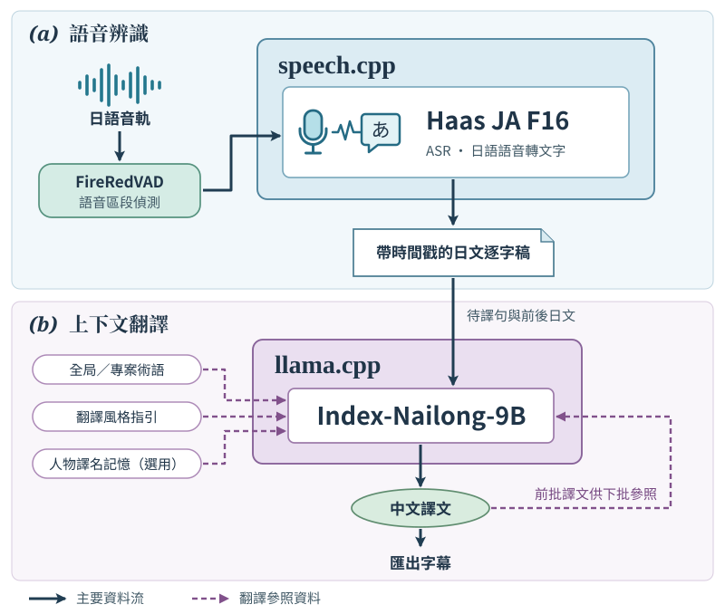
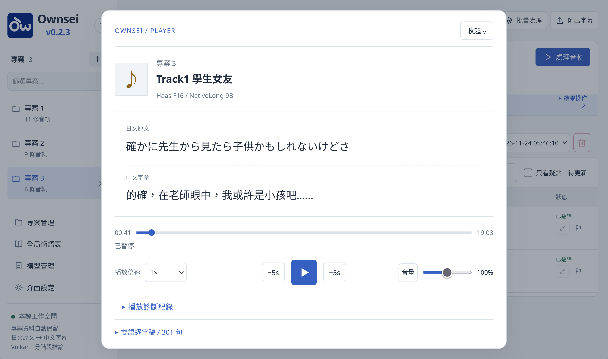

<p align="center">
  <picture>
    <source media="(prefers-color-scheme: dark)" srcset="frontend/public/ownsei-logo-dark.png">
    
  </picture>
</p>

# Ownsei — 日語音聲字幕工具

Ownsei 使用 Haas JA 將日語音聲轉錄成帶時間戳的逐字稿，再由 Index-NativeLong 參照前後文翻譯成中文，在指定譯文風格的同時保持長文用詞的一致性，改善前後人名或稱呼被翻譯成不同詞彙的問題。
轉錄與翻譯皆在本地執行，並透過 Vulkan 加速，支援 NVIDIA 、AMD 和 Intel 各家的顯卡（VRAM 需 8GB 以上）。

**[下載 Linux／Windows 版](https://github.com/ribeye0/ownsei/releases)**


畫面中正在翻譯第 4 軌，前 3 軌已匯出，後 2 軌仍在等候。

## 從一段對話做出可以回聽的字幕

音聲作品裡，角色常省略主詞，也會在對話中交替使用名字、暱稱和敬稱。單看一句「黙っちゃった」，很難決定該譯成「怎麼不說話了？」還是「他沉默了」。這個選擇取決於前一句在問誰，以及眼前的人有沒有回答。Ownsei 把**帶時間戳的日文逐字稿**保留下來：翻譯模型能讀到來回對話，聽眾也能從一句中文跳回原音，自己判斷角色的語氣。



**圖 1　轉錄與翻譯流程。** 實線沿著音軌、日文逐字稿、中文譯文到字幕匯出。紫色虛線是翻譯模型可以參照的資料，其中右側回路將前批譯文帶回下一批，讓先前採用的稱呼能沿用到後面的對話。[English diagram](docs/architecture.en.svg)

## 方法與模型

| 階段 | 預設做法 | 可以調整的地方 |
| --- | --- | --- |
| 語音切分 | FireRedVAD 透過 ncnn 在 CPU 上找出有人聲的區段，再送入轉錄模型。 | 耳語被切得太碎時可降低門檻，也可換成 Silero VAD 或使用固定時間窗。 |
| 日文轉錄 | speech.cpp 執行 Haas JA F16，使用模型輸出的時間戳組成逐字稿。 | 顯存較少時可選 Q8_0。辨識有誤時可先回聽、修正日文，再重譯該段。 |
| 中文翻譯 | llama.cpp 執行 Index-NativeLong 9B，分批讀入待譯句、前後日文與前批中文。預設上下文容量為 64K。 | 可選繁體或簡體，調整上下文容量（8K–256K）及譯文風格。常用詞可在全局共用，角色名與暱稱可在專案內指定。 |

**同一份逐字稿可以試不同譯風。** 除了 NativeLong，也可選 Index-Translate 9B，或以日語音聲台詞與人工中文字幕微調的 Ownsei SFT48。SFT48 著重於成人向音聲的用詞與字幕標點。這兩個模型預設搭配 Qwen3.5 4B 整理人物譯名，使用者指定的術語優先。每次翻譯獨立保存，可以切換版本，比較同一句話的不同譯法。

## 端到端實測

在 Linux Vulkan 發布包 **0.2.1** 上，以 **Radeon RX 9070 XT** 處理一段 22 秒的日語對話。這次使用固定時間窗、Haas JA F16 與 NativeLong 9B Q4_K_M，上下文設為 8K，關閉人物譯名記憶。

| 日文轉錄 | 中文翻譯 | 整個任務（含匯出） | 輸出 |
| ---: | ---: | ---: | --- |
| 0.74 秒 | 4.66 秒 | **5.57 秒** | 7 句有時間戳的日中雙語字幕 |

耗時取自這次任務的起訖紀錄，從已匯入的音軌開始計時。整部作品的翻譯速度還會受前文長度、批次數量及顯存影響。

## 從整部作品找到一句台詞

匯入作品目錄後，可先挑一軌試譯，再勾選其餘音軌批量處理。同一音軌若同時有 WAV 與 MP3，預設只匯入 WAV。任務紀錄會列出每一軌的進度。

只記得譯文中的幾個字，也能在逐字稿裡搜尋，點時間戳跳回原音。展開播放器就能邊聽邊看當句的日文和中文，也可以倒回五秒，再聽一次角色的語氣。



匯出可選日文、中文或雙語，支援 VTT、SRT、LRC、ASS 與 JSONL。例如為 `01 プロローグ.wav` 匯出中文 VTT，預設檔名就是 `01 プロローグ.vtt`。字幕可直接存到音檔旁，或集中放在 `sub/`。

## 安裝

| 平台 | 發布檔 | 解壓後啟動 |
| --- | --- | --- |
| Windows 10／11 x64 | `ownsei-版本號-windows-x64-vulkan.zip` | 雙擊 `Ownsei.cmd` |
| Linux x86-64（glibc 2.38 以上） | `ownsei-版本號-linux-x64-vulkan.tar.gz` | 執行 `bash ownsei.sh` |

首次啟動會安裝 Python 環境並開啟瀏覽器。在「模型管理與環境檢查」按 **準備基本組合**，即可下載 FireRedVAD、Haas JA F16 與 NativeLong 9B。FireRedVAD 的 ncnn CPU 引擎已隨包提供，更新舊版後在模型管理重新準備 FireRedVAD 即可。首次安裝與下載建議預留 12–15 GiB。Linux 另需 curl、FFmpeg 與 ffprobe。

### 模型庫與設定

在「模型管理與環境檢查」可以看到模型庫與下載快取的實際路徑、模型用量和剩餘磁碟空間。首次下載前可按「更改位置」選擇其他磁碟。

| 用途 | Linux 預設 | Windows 預設 |
| --- | --- | --- |
| 全局設定 | `~/.config/ownsei/` | `%APPDATA%\ownsei\` |
| 已安裝模型 | `~/.local/share/ownsei/models/` | `%LOCALAPPDATA%\ownsei\models\` |
| 下載快取與續傳檔 | `~/.cache/ownsei/` | `%LOCALAPPDATA%\ownsei\cache\` |

Linux 分別支援 `XDG_CONFIG_HOME`、`XDG_DATA_HOME`、`XDG_CACHE_HOME`。自訂模型庫的下載快取在同磁碟，例如選 `D:\Ownsei\Models` 時使用 `D:\Ownsei\Models.ownsei-download-cache`；若模型庫本身是掛載點，快取放在其下的 `.ownsei-download-cache`。停止下載後可清理快取，已安裝模型仍可使用。

**沿用與搬移。** 上一版設定目錄下的 `models/` 會自動沿用。選「使用這個模型庫」可直接切換至空資料夾或既有 Ownsei 模型庫，原庫留在原處。「搬移已安裝模型」會校驗目的地，再切換位置並清理來源的已搬移檔案。未完成的下載、舊版快取與其他檔案留在原處。模型庫由同一系統使用者的各個新版 Ownsei 共用。

| 設定檔 | 內容與修改入口 |
| --- | --- |
| `interface.json` | 介面語言、主題、匯出預設、播放與處理偏好，由對應介面儲存。 |
| `global-preferences.json` | 全局術語表的日文、譯詞與啟用狀態，由術語編輯器維護。 |
| `storage.json` | 選擇或搬移後記錄模型庫的絕對路徑，由模型管理維護。Linux 放在全局設定目錄，Windows 放在 `%LOCALAPPDATA%\ownsei\`。 |

備份自訂術語與偏好時保留前兩個設定檔。專案、作品術語與校訂字幕存於安裝目錄的 `workspace/`，換版時一併保留。

更早的版本把模型放在程式目錄的 `models/`。可在「更改位置」直接選用該資料夾；若要複製舊模型與全局術語，先關閉舊版，再從新版安裝目錄執行 `.venv/bin/ownsei import-user-data "/舊版安裝目錄"`（Windows PowerShell 使用 `.\.venv\Scripts\ownsei.exe import-user-data "D:\舊版安裝目錄"`）。這會複製舊模型與全局術語，略過目的地已有的項目。要沿用專案可再複製 `workspace/`；原始音檔請留在原處。瀏覽器偏好會在首次以原瀏覽器及連接埠開啟新版時匯入。

### 解除安裝

先關閉所有 Ownsei 後端，等下載與處理任務結束。Linux 在發布包內執行 `bash uninstall.sh`，Windows 雙擊 `Uninstall.cmd`。畫面會列出安裝、模型與快取位置，輸入 `DELETE` 後才會移除。想先看逐檔清單，可執行 `bash uninstall.sh --dry-run` 或 `.\Uninstall.cmd --dry-run`。

清理範圍包含這份發布包、專用執行環境，以及同帳號共用的 Ownsei 設定、模型與下載快取。工具會檢查目前模型庫和舊版預設位置；若曾切換到其他模型庫，可加上 `--models-dir "舊模型庫的絕對路徑"`，多個位置可重複指定。安裝目錄的 `workspace/`、外部專案、原始音檔和匯出的字幕會保留。瀏覽器記住的上次選取音軌與專案屬於網站資料，可從瀏覽器清除。

## 開發

Python 3.12、FastAPI、React 與 TypeScript。Linux 從原始碼啟動另需 Node.js 與 npm。

```sh
bash ownsei.sh         # 安裝依賴並啟動
bash scripts/check.sh  # 執行檢查、測試與前端建置
```

## License

[MIT](LICENSE)
