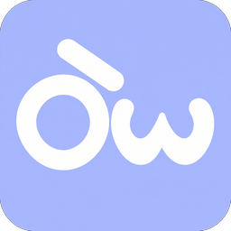
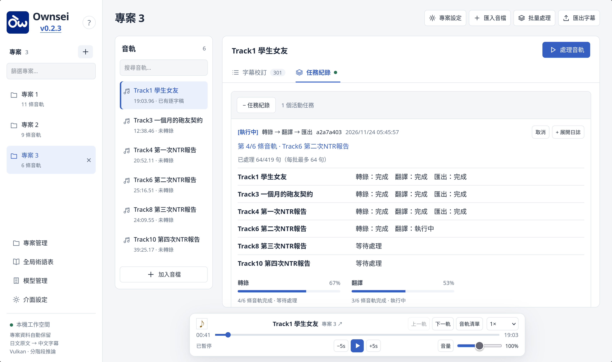
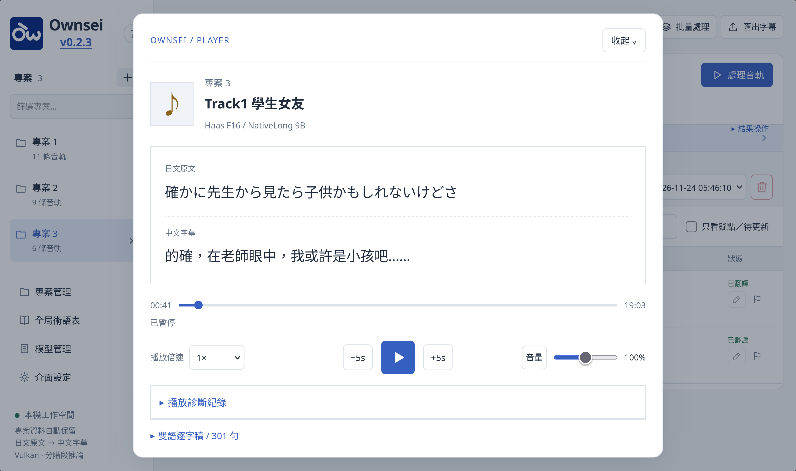
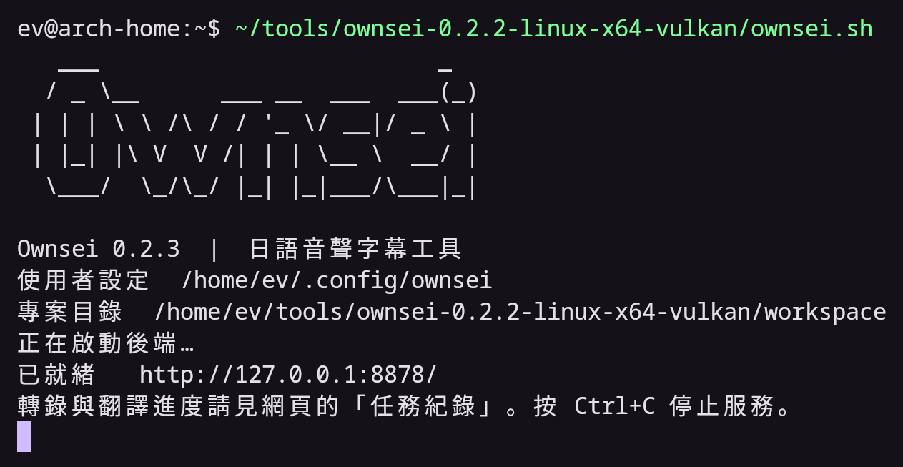

<p align="center">
  
</p>

<h1 align="center">Ownsei</h1>

Ownsei 使用 Haas JA 將日語音聲轉錄成帶時間戳的逐字稿，再由 Index-NativeLong 參照前後文翻譯成中文，在指定譯文風格的同時保持長文用詞的一致性，改善前後人名或稱呼被翻譯成不同詞彙的問題。
轉錄與翻譯皆在本地執行，並透過 Vulkan 加速，支援 NVIDIA 、AMD 和 Intel 各家的顯卡（VRAM 需 8GB 以上）。

支援簡體中文與繁體中文，有專門設定獨立的 prompts，並允許分別修改。

**[下載 Linux／Windows Vulkan 版](https://github.com/ribeye0/ownsei/releases)**

## 使用說明

| 平台 | 發布檔 | 解壓後啟動 |
| --- | --- | --- |
| Windows 10／11 x64 | `ownsei-版本號-windows-x64-vulkan.zip` | 雙擊 `Ownsei.cmd` |
| Linux x86-64（glibc 2.38 以上） | `ownsei-版本號-linux-x64-vulkan.tar.gz` | 執行 `bash ownsei.sh` |

首次安裝與下載基本模型建議預留 12–15 GiB。Linux 另需 curl、FFmpeg 與 ffprobe。

1. 解壓後啟動 Ownsei，首次執行會安裝 Python 環境並開啟網頁介面。在「模型管理與環境檢查」點「準備基本組合」，下載 FireRedVAD、Haas JA F16 與 NativeLong 9B。
2. 新增專案，匯入音檔或作品目錄。選一條音軌點「處理音軌」，或用「批量處理」勾選多條音軌，一次轉錄與翻譯。
3. 處理完成後，點「匯出字幕」，選擇格式、語言與儲存位置。需要核對時，可在逐字稿搜尋日文或中文，點時間戳回聽原音。

點左上角的版本號開啟「關於 Ownsei」，可檢查新版並下載對應平台的更新包。下載時可關閉視窗繼續使用，稍後再按「安裝並重新啟動」。更新沿用目前的安裝目錄、工作區與模型庫。私人儲存庫可在啟動前設定具備該庫 Contents 讀取權限的 `GH_TOKEN`。

## 架構

<p align="center">
  <a href="docs/architecture.svg"></a>
</p>

## 特色

- **中日雙語字幕**　每句日文與對應的中文譯文共用時間軸，可直接匯出雙語字幕，也可單獨輸出日文或中文。
- **一套 Vulkan 後端支援三家顯卡**　NVIDIA、AMD 與 Intel 顯卡都使用 Vulkan 發布包。有支援 Vulkan 的顯示驅動即可執行 GPU 推理，無須配對 CUDA 版本、安裝 ROCm 或 PyTorch。
- **全局與專案術語表**　常用詞的譯法可跨作品沿用，角色名、暱稱或作品專有名詞則放在專案內。術語可逐項啟用或停用。
- **Index-NativeLong 讀得到整段對話**　翻譯當句時可參照前後日文，幫助判斷省略的主語和對話對象。長音軌分批翻譯時，也能沿用前批中文已採用的人名與稱呼。
- **Haas JA 原生輸出時間戳**　這個 616M 參數的日語辨識模型在轉錄時一併輸出時間資訊。Ownsei 可直接建立能逐句回聽的日文字幕，省去額外的對齊模型。

## 方法

### 語音切分與轉錄

1. **音訊前處理**　FFmpeg 將輸入音軌轉為 16 kHz、單聲道、16-bit PCM，供語音偵測與轉錄共用。同一音軌有 WAV 與 MP3 兩種版本時，目錄匯入優先選用 WAV。
2. **語音切分**　預設用 FireRedVAD 與 ncnn 在 CPU 上偵測語音區段。判定門檻、分句靜音長度與區段前後保留時間均可調整，也可改用 Silero VAD 或固定時間窗。
3. **日文轉錄**　speech.cpp 透過 Vulkan 執行 Haas JA，將各區段的辨識結果與時間戳換算到原音軌的時間軸。模型預設為 F16，也提供較省顯存的 Q8_0。

### 上下文翻譯

預設使用 llama.cpp 執行 **Index-Nailong-9B**（介面名稱為 NativeLong 9B），量化格式為 Q4_K_M。日文逐字稿獨立保存，同一份轉錄可以重譯、切換模型或比較不同譯文版本。

- **分批與上下文**　每批最多翻譯 64 句。容量足夠時，模型可參照整條音軌的日文。超出預算時，先移除較早的翻譯紀錄，再取待譯句前後的連續日文。上下文上限預設為 64K tokens，可在 8K 到 256K 間分級選擇。
- **跨批一致性**　NativeLong 預設參照待譯句之前已完成的日中對照。術語與風格指引會隨待譯句送入模型。
- **選用模型**　Index-Translate 9B 與 Ownsei SFT48 預設搭配 Qwen3.5 4B 整理人物譯名，使用者指定的術語優先。

Ownsei SFT48 是我用日語音聲台詞與人工中文字幕微調的 Index-Translate 9B，主要調整成人向用詞、角色口吻與字幕標點。和原版相比，兩者的差異主要在譯風，哪個譯法更貼切仍要看當句台詞。[模型卡與 GGUF 下載](https://huggingface.co/yzk9/index-translate-asmr-9B)

### 字幕輸出

每句譯文沿用對應日文的時間戳，可搜尋、回聽與校訂。匯出可選日文、中文或雙語，支援 VTT、SRT、LRC、ASS 與 JSONL。字幕預設沿用音檔名稱，例如 `01 プロローグ.wav` 對應 `01 プロローグ.vtt`，可存至音檔目錄或其下的 `sub/`。

## 介面截圖

<p align="center">
  <a href="docs/screenshots/batch-progress.webp"></a>
</p>

<p align="center">
  <a href="docs/screenshots/bilingual-player.webp"></a>
</p>

<p align="center">
  <a href="docs/screenshots/backend-console.webp"></a>
</p>

## 設定檔與模型存放位置

| 用途 | Linux 預設 | Windows 預設 |
| --- | --- | --- |
| 設定檔 | `~/.config/ownsei/` | `%APPDATA%\ownsei\` |
| 模型 | `~/.local/share/ownsei/models/` | `%LOCALAPPDATA%\ownsei\models\` |
| 下載快取 | `~/.cache/ownsei/` | `%LOCALAPPDATA%\ownsei\cache\` |

Linux 支援 `XDG_CONFIG_HOME`、`XDG_DATA_HOME` 與 `XDG_CACHE_HOME`。模型庫可在「模型管理與環境檢查」選擇或搬移，實際路徑以介面顯示為準。

設定目錄中的 `interface.json` 儲存介面偏好，`global-preferences.json` 儲存全局術語。`storage.json` 記錄自訂模型庫位置，Linux 位於設定目錄，Windows 位於 `%LOCALAPPDATA%\ownsei\`。專案、專案術語與字幕存於安裝目錄的 `workspace/`。

解除安裝時，Linux 執行 `bash uninstall.sh`，Windows 執行 `Uninstall.cmd`，依提示移除程式、共用設定與模型。工作區與音檔會保留。

## 開發

Python 3.12、FastAPI、React 與 TypeScript。Linux 從原始碼啟動另需 Node.js 與 npm。

```sh
bash ownsei.sh         # 安裝依賴並啟動
bash scripts/check.sh  # 執行檢查、測試與前端建置
```

## License

Ownsei 採用 [MIT](LICENSE)。隨附的 [llama.cpp](third_party/llama.cpp-LICENSE) 與 [speech.cpp](third_party/speech.cpp-LICENSE) 也採用 MIT。其他元件與模型授權見[第三方聲明](THIRD_PARTY_NOTICES.md)。
