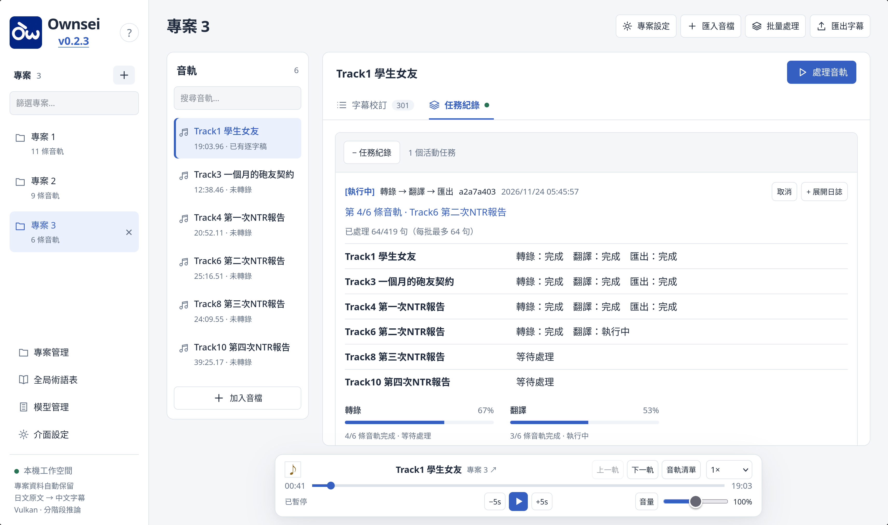

# Ownsei — 日語音聲字幕工具

Ownsei 先將日語音軌轉錄成帶時間戳的逐字稿，再參照同一音軌的上下文翻譯成繁體或簡體中文。轉錄與翻譯皆在本機透過 Vulkan 執行，支援 NVIDIA、AMD 與 Intel 顯卡（顯存需求為 8 GB 以上）。

[下載 Linux／Windows 版](https://github.com/ribeye0/ownsei/releases) · [英文架構圖](docs/architecture.en.svg)

## 語音切分與轉錄

1. **音訊前處理**　FFmpeg 將輸入音軌轉為 16 kHz、單聲道、16-bit PCM，供語音偵測與轉錄共用。同一音軌有 WAV 與 MP3 兩種版本時，目錄匯入優先選用 WAV。
2. **語音切分**　預設用 FireRedVAD 與 ncnn 在 CPU 上偵測語音區段。判定門檻、分句靜音長度與區段前後保留時間均可調整，也可改用 Silero VAD 或固定時間窗。
3. **日文轉錄**　speech.cpp 透過 Vulkan 執行 Haas JA，將各區段的辨識結果與時間戳換算到原音軌的時間軸。模型預設為 F16，也提供較省顯存的 Q8_0。

## 上下文翻譯

預設使用 llama.cpp 執行 **Index-Nailong-9B**（介面名稱為 NativeLong 9B），量化格式為 Q4_K_M。日文逐字稿獨立保存，同一份轉錄可以重譯、切換模型或比較不同譯文版本。

- **分批與上下文**　每批最多翻譯 64 句。容量足夠時，模型可參照整條音軌的日文。超出預算時，先移除較早的翻譯紀錄，再取待譯句前後的連續日文。上下文上限預設為 64K tokens，可在 8K 到 256K 間分級選擇。
- **跨批一致性**　NativeLong 預設參照待譯句之前已完成的日中對照。全局術語表可跨作品共用，專案術語表可指定角色名與暱稱，翻譯風格指引則用來調整語氣與用詞。
- **選用模型**　Index-Translate 9B 與 Ownsei SFT48 預設搭配 Qwen3.5 4B 整理人物譯名，使用者指定的術語優先。SFT48 使用日語音聲台詞與人工中文字幕微調，著重成人向用詞及字幕標點。

## 字幕輸出

每句譯文沿用對應日文的時間戳，可搜尋、回聽與校訂。匯出可選日文、中文或雙語，支援 VTT、SRT、LRC、ASS 與 JSONL。字幕預設沿用音檔名稱，例如 `01 プロローグ.wav` 對應 `01 プロローグ.vtt`，可存至音檔目錄或其下的 `sub/`。

## 效能實測

以 Radeon RX 9070 XT 在 Linux Vulkan v0.2.1 處理一段 22 秒的日語對話。測試使用固定時間窗、Haas JA F16、NativeLong 9B Q4_K_M 與 8K 上下文，關閉人物譯名記憶。計時從已匯入的音軌開始。

| 日文轉錄 | 中文翻譯 | 總耗時（含匯出） | 輸出 |
| ---: | ---: | ---: | --- |
| 0.74 秒 | 4.66 秒 | 5.57 秒 | 7 句日中雙語字幕 |

## 安裝

| 平台 | 發布檔 | 解壓後啟動 |
| --- | --- | --- |
| Windows 10／11 x64 | `ownsei-版本號-windows-x64-vulkan.zip` | 雙擊 `Ownsei.cmd` |
| Linux x86-64（glibc 2.38 以上） | `ownsei-版本號-linux-x64-vulkan.tar.gz` | 執行 `bash ownsei.sh` |

首次啟動會安裝 Python 環境並開啟瀏覽器。在「模型管理與環境檢查」按 **準備基本組合**，即可下載 FireRedVAD、Haas JA F16 與 NativeLong 9B。FireRedVAD 的 ncnn CPU 引擎已隨包提供，更新舊版後在模型管理重新準備 FireRedVAD 即可。首次安裝與下載建議預留 12–15 GiB。Linux 另需 curl、FFmpeg 與 ffprobe。

### 模型庫與設定

在「模型管理與環境檢查」可以看到模型庫與下載快取的實際路徑、模型用量和剩餘磁碟空間。首次下載前可按「更改位置」選擇其他磁碟。

| 用途 | Linux 預設 | Windows 預設 |
| --- | --- | --- |
| 全局設定 | `~/.config/ownsei/` | `%APPDATA%\ownsei\` |
| 已安裝模型 | `~/.local/share/ownsei/models/` | `%LOCALAPPDATA%\ownsei\models\` |
| 下載快取與續傳檔 | `~/.cache/ownsei/` | `%LOCALAPPDATA%\ownsei\cache\` |

Linux 分別支援 `XDG_CONFIG_HOME`、`XDG_DATA_HOME`、`XDG_CACHE_HOME`。自訂模型庫的下載快取在同磁碟，例如選 `D:\Ownsei\Models` 時使用 `D:\Ownsei\Models.ownsei-download-cache`；若模型庫本身是掛載點，快取放在其下的 `.ownsei-download-cache`。停止下載後可清理快取，已安裝模型仍可使用。

**沿用與搬移。** 上一版設定目錄下的 `models/` 會自動沿用。選「使用這個模型庫」可直接切換至空資料夾或既有 Ownsei 模型庫，原庫留在原處。「搬移已安裝模型」會校驗目的地，再切換位置並清理來源的已搬移檔案。未完成的下載、舊版快取與其他檔案留在原處。模型庫由同一系統使用者的各個新版 Ownsei 共用。

| 設定檔 | 內容與修改入口 |
| --- | --- |
| `interface.json` | 介面語言、主題、匯出預設、播放與處理偏好，由對應介面儲存。 |
| `global-preferences.json` | 全局術語表的日文、譯詞與啟用狀態，由術語編輯器維護。 |
| `storage.json` | 選擇或搬移後記錄模型庫的絕對路徑，由模型管理維護。Linux 放在全局設定目錄，Windows 放在 `%LOCALAPPDATA%\ownsei\`。 |

備份自訂術語與偏好時保留前兩個設定檔。專案、作品術語與校訂字幕存於安裝目錄的 `workspace/`，換版時一併保留。

更早的版本把模型放在程式目錄的 `models/`。可在「更改位置」直接選用該資料夾；若要複製舊模型與全局術語，先關閉舊版，再從新版安裝目錄執行 `.venv/bin/ownsei import-user-data "/舊版安裝目錄"`（Windows PowerShell 使用 `.\.venv\Scripts\ownsei.exe import-user-data "D:\舊版安裝目錄"`）。這會複製舊模型與全局術語，略過目的地已有的項目。要沿用專案可再複製 `workspace/`；原始音檔請留在原處。瀏覽器偏好會在首次以原瀏覽器及連接埠開啟新版時匯入。

### 解除安裝

先關閉所有 Ownsei 後端，等下載與處理任務結束。Linux 在發布包內執行 `bash uninstall.sh`，Windows 雙擊 `Uninstall.cmd`。畫面會列出安裝、模型與快取位置，輸入 `DELETE` 後才會移除。想先看逐檔清單，可執行 `bash uninstall.sh --dry-run` 或 `.\Uninstall.cmd --dry-run`。

清理範圍包含這份發布包、專用執行環境，以及同帳號共用的 Ownsei 設定、模型與下載快取。工具會檢查目前模型庫和舊版預設位置；若曾切換到其他模型庫，可加上 `--models-dir "舊模型庫的絕對路徑"`，多個位置可重複指定。安裝目錄的 `workspace/`、外部專案、原始音檔和匯出的字幕會保留。瀏覽器記住的上次選取音軌與專案屬於網站資料，可從瀏覽器清除。

## 介面截圖




## 開發

Python 3.12、FastAPI、React 與 TypeScript。Linux 從原始碼啟動另需 Node.js 與 npm。

```sh
bash ownsei.sh         # 安裝依賴並啟動
bash scripts/check.sh  # 執行檢查、測試與前端建置
```

## License

[MIT](LICENSE)
